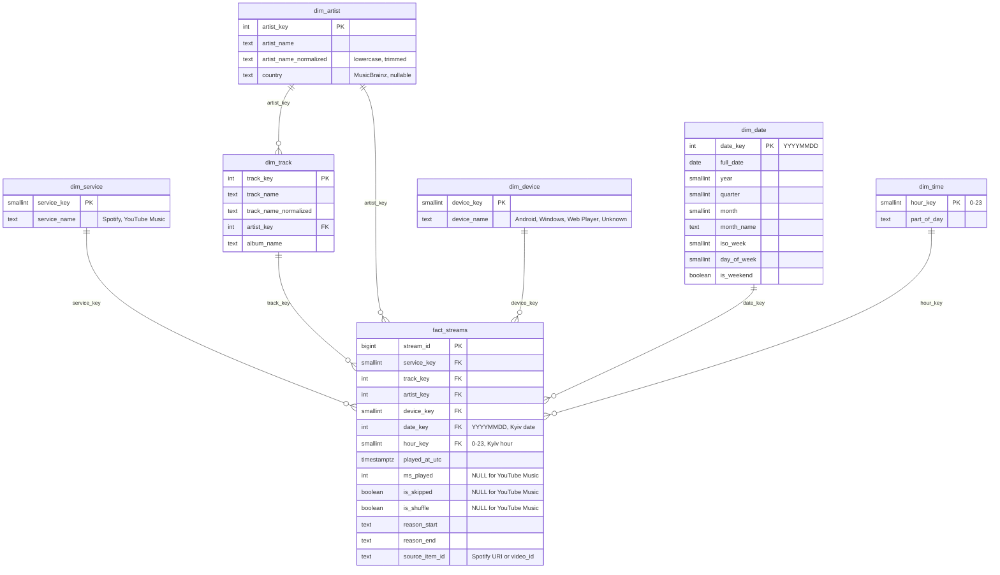

# Data model

`data/raw` (JSON) → `src/extract_*.py` → `data/processed/*.csv` → PostgreSQL `staging` → `core` (star schema) → views → Power BI.

All timestamps are stored in UTC (`timestamptz`). Dates and hours are converted to Europe/Kyiv only when the core keys and views are built.

## 1. Staging

There is one table per source CSV, with the same columns in the same order. Each row is one play.

### `staging.stg_spotify_streams`

Built by `src/extract_spotify.py` from `Streaming_History_Audio_*.json`.

| Column | Type | Rule |
|---|---|---|
| played_at_utc | timestamptz | `ts - ms_played` (start of playback) |
| ended_at_utc | timestamptz | `ts` (Spotify logs the end of playback) |
| ms_played | integer | as exported; rows with 0 are kept here and filtered in SQL |
| track_name | text | `master_metadata_track_name` |
| artist_name | text | `master_metadata_album_artist_name` |
| album_name | text | `master_metadata_album_album_name` |
| spotify_track_uri | text | never NULL (music only) |
| device_raw | text | original `platform` value |
| device_name | text | Android / Windows / Web Player / Unknown |
| reason_start, reason_end | text | as exported |
| is_shuffle, is_skipped, is_offline | boolean | `shuffle`, `skipped`, `offline` |
| source_file | text | JSON file name |

- **Key:** `(ended_at_utc, spotify_track_uri)`. When a play is repeated with a different `ms_played`, the longest one is kept.
- **Dropped:** podcasts and audiobooks (rows without `spotify_track_uri`), plus the fields `ip_addr`, `offline_timestamp`, `conn_country`, `incognito_mode` and all `episode_*` / `audiobook_*` fields. They are never loaded into memory.

### `staging.stg_ytm_history`

Built by `src/extract_ytm.py` from `історія переглядів.json`.

| Column | Type | Rule |
|---|---|---|
| played_at_utc | timestamptz | `time` (start of playback) |
| track_name | text | `title` without the leading `Ви дивилися ` |
| artist_name | text | `channel_name` without a trailing ` - Topic` |
| channel_name | text | `subtitles[0].name` |
| is_topic_channel | boolean | whether the channel name ended with ` - Topic` |
| video_id | text | `v=` parameter of `titleUrl` (11 characters) |
| source_file | text | JSON file name |

- **Kept:** records with `header = "YouTube Музика"` or a `titleUrl` host of `music.youtube.com`.
- **Dropped:** regular YouTube records, and records without `subtitles` (removed videos).
- **Key:** `(played_at_utc, video_id)`.

**CSV format (both files):** UTF-8 without BOM, comma separator, header row, NULL as an empty field, booleans as `true` / `false`, timestamps as `YYYY-MM-DDTHH:MM:SS.mmmZ`, `\n` line endings.

## 2. Core star schema

| Table | One row per | Notes |
|---|---|---|
| fact_streams | play, from either service | `source_item_id` = Spotify URI or YouTube `video_id` |
| dim_service | service | Spotify, YouTube Music |
| dim_artist | `artist_name_normalized` | the normalized name is used to match artists across platforms; `country` comes later from MusicBrainz |
| dim_track | `(artist_name_normalized, track_name_normalized)` | the same song with several Spotify URIs, or on both services, becomes one track |
| dim_device | device | Android, Windows, Web Player, Unknown |
| dim_date | Kyiv calendar day | built from `played_at_utc` converted to Europe/Kyiv |
| dim_time | Kyiv hour | night 0-5, morning 6-11, afternoon 12-17, evening 18-23 |

**Power BI model:** dim_artist and dim_track are each related only to fact_streams (`fact_streams -> dim_artist`, `fact_streams -> dim_track`). The `dim_track -> dim_artist` relationship exists only in the database, as a foreign key that protects data integrity, and is not added to the Power BI model. With it, Power BI would have two filter paths from artist to fact and would make one of them inactive.

## 3. NULL / Unknown policy

- Numeric and boolean facts that a platform does not have stay NULL. For YouTube Music, `ms_played`, `is_skipped` and `is_shuffle` are NULL. The text "N/A" is never stored.
- Missing text attributes in dimensions use the member `'Unknown'`. For YouTube Music this applies to the album and the device.
- "N/A" appears only in the report layer.

## 4. Metric rules

- A Spotify play counts as a **qualified play** when `ms_played >= 30000`.
- **Cross-platform play counts:** Spotify rows with `ms_played > 0` vs all YouTube Music rows. YouTube Music has no duration, so the 30-second filter cannot be applied to both services.
- **Spotify-only metrics** (skips, minutes) use qualified plays (`ms_played >= 30000`).
- The fair comparison window is Spotify Mar-Jun 2026 vs YouTube Music Jul-Sep 2026 (by Kyiv date).

## 5. Known limitations

- YouTube Music has no duration, skip or album data.
- Artist names differ between platforms, for example `Artist - Topic` channels and `(Official Video)` titles.
- The Spotify history starts in May 2022, so Ukrainization is a 2022-2026 trend with no pre-invasion baseline.
- Genres will come from MusicBrainz tags, which are community-sourced.
- A YouTube Music record means a play started, not a play finished.
